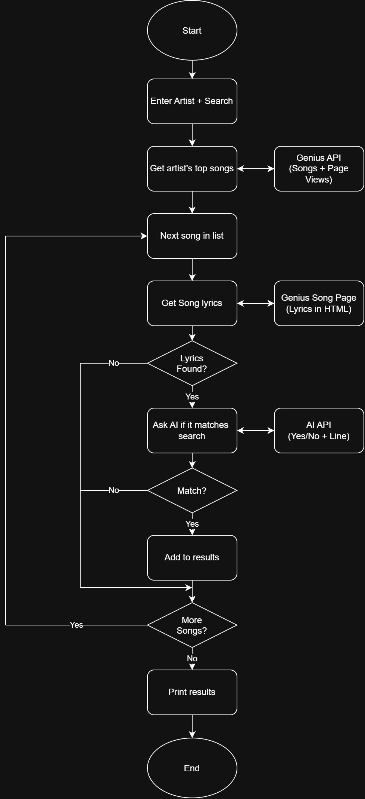

# Lyric-Finder

## Project Goal
I often know an artist mentioned something in one of their songs but can't remember which one. Lyric-Finder is a Java program where you pick an artist (like Lil Uzi Vert), describe what you're looking for in plain English (like "times Uzi mentioned standing on money"), and it uses AI to search their lyrics and list every matching song, ranked from most to least popular.

## MVP Scope
- Console menu: pick an artist and type what you're looking for in the lyrics
- Get the artist's top songs from the Genius API, sorted by popularity
- Get each song's lyrics from its Genius song page
- Send each song's lyrics + the search to an AI API, which answers yes or no and gives the matching line
- Print matching songs from most to least popular, with the matching line
- Skip songs with no lyrics and show progress while running

## Future Plans
- Search across all artists instead of one at a time (e.g., "songs where Drake gets dissed")
- Save results to a JSON file so repeat searches are instant
- A backup lyrics source in case a Genius page fails

## Tech Stack
- Language: Java
- Libraries: Gson (reading JSON), Jsoup (reading lyrics from Genius pages), Java's built-in HttpClient
- External Sources: Genius API (songs + popularity), Genius song pages (lyrics), an AI API (checks if lyrics match the search)
- Data Storage: None for the MVP; everything is fetched live
- Tools: IntelliJ, Git/GitHub

## Planning Docs
- [Eisenhower Matrix](docs/Eisenhower%20Matrix.pdf)
- [System Diagram](docs/FinalSystemDiagram.png)

